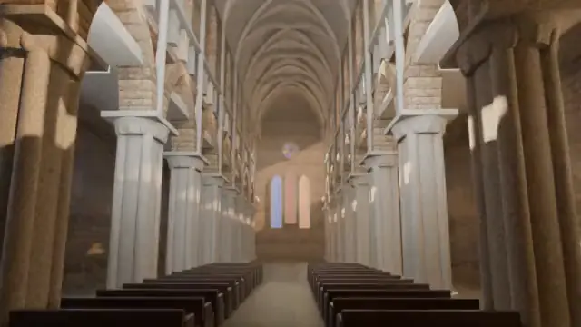

# 3D Agent Studio

Make editable Blender animations from prompts and reference files. Write a Python scene script or ask your agent to write one. Studio runs it locally and delivers a Blender project, a silent MP4, and review boards you can inspect before approving a full-resolution render.

[Documentation](https://nicolas-found42.github.io/3d-agent-studio/) · [First render](docs/quickstart.md) · [Install for an agent](docs/marketplace.md) · [Browse examples](docs/examples.md)

[](docs/examples.md#gothic-nave)

*Gothic Nave, a draft rendered with Studio. [See the brief, clip, and review boards](docs/examples.md#gothic-nave).*

## Get started

### Use from a terminal

Install Python 3.11+, [uv](https://docs.astral.sh/uv/), Blender 5.2+, and FFmpeg with `libx264` and `ffprobe`. Run this in a terminal on the computer that will render.

```sh
git clone https://github.com/nicolas-found42/3d-agent-studio.git
cd 3d-agent-studio
uv sync --locked
uv run --locked 3d-agent-studio doctor
```

When `doctor` reports the Blender and FFmpeg versions, run the [first render](docs/quickstart.md) to produce a two-second clip and its review boards.

### Use from an agent

Install the [marketplace plugin](docs/marketplace.md) or start the [local Model Context Protocol (MCP) server](docs/agents.md). Give the agent the bundled [Studio skill](skills/3d-agent-studio/SKILL.md) so it can author the scene and run the review workflow.

> Make a five-second horizontal video of a fog-filled stone nave at dawn. Move slowly toward the crossing and show me the draft boards before rendering the master.

## How a render works

1. **Probe.** Studio builds the scene in Blender, renders three stills, and estimates the time for the draft and master.
2. **Draft.** Play the preview MP4 and inspect its timeline, alternate angles, and applicable reference or loop boards.
3. **Master.** Approve the current draft evidence to render at full resolution. Studio delivers the editable `.blend`, the scene script, the finished MP4, and asset credits.

Blender runs locally. Give Studio a job directory you own and run only Python scene scripts you trust. See the [workflow guide](docs/workflow.md#local-files-and-script-trust) for where your files go and how script checks work.

## Documentation

- [Render workflow](docs/workflow.md), including references, revisions, and masters
- [Command and MCP reference](skills/3d-agent-studio/references/operations.md) and [scene kit](skills/3d-agent-studio/references/kit.md)
- [Agent compatibility](docs/compatibility.md) and [v0.3.0 migration](docs/v0.3.0.md)

## Verification

Run the test suite and package checks from the repository root.

```sh
uv run --locked --extra mcp python -m unittest discover -s tests -v
STUDIO_RENDER_TESTS=1 uv run --locked --extra mcp python -m unittest tests.test_workflow.Render -v
uv lock --check
uv build
```

After editing the scene kit, regenerate its reference with `uv run --locked python tools/kit_reference.py`. See [render verification](docs/render-verification.md) for decoded-media checks and [documentation maintenance](docs/publishing.md) for testing the docs site.

[MIT license](LICENSE)
