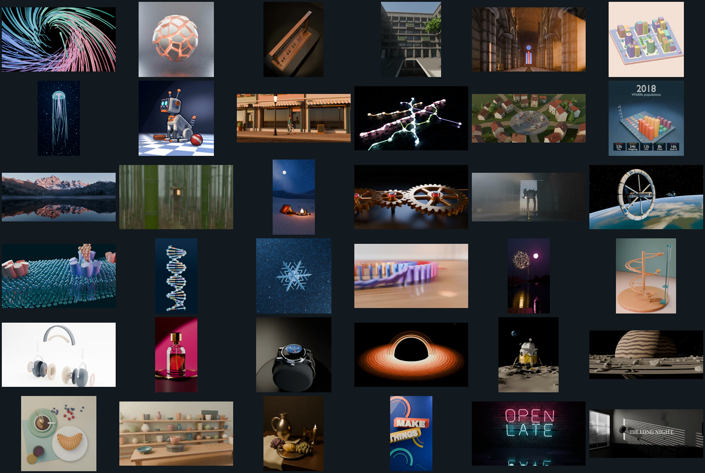

# Example library art direction

The contact sheet uses the shipped posters in category and slug order. Each row of observations links to the example's script, actual clip and visual-review receipt.



## Cover revisions

- **Neon Sign Sting** originally reached its automatic cover while the cyan LATE line was still dark. The revised ignition cues preserve letter-by-letter flicker and finish both lines before the one-third-frame cover. The new poster shows the reflection in the foreground puddle. [Review receipt](../src/agent_studio/examples/neon-sign-sting/review.json)
- **Noir Title Card** originally showed a bare wall and blind shadows in its cover. The revised fade starts earlier and the ivory paint is brighter. The opening retains the unlettered wall, and the normal cover contains the legible title inside the projected stripes. [Review receipt](../src/agent_studio/examples/noir-title-card/review.json)

## Library patterns

- Cool navy and cyan recur in Jellyfish Drift, the three micro/macro studies and City Network Pulses. Their distinct silhouettes, panel proportions and viewpoints keep them readable as a tall bell, a raked membrane, a vertical ladder, a centered dendrite and a street map.
- The dark centered shots in Neon Sign Sting, Noir Title Card, Black Hole Accretion and Hangar Door Reveal use legible contrasts in lighting and depth. Neon uses two saturated tubes, Noir projects diagonal hard stripes, the black hole has a luminous circular void, and the hangar holds a small figure in a bright rear doorway.
- Pendulum Wave and Clockwork Gear Train both use brass and a dark field. The pendulum shows the full diagonal machine from above. The macro gear shot places the viewer level with the teeth. Dutch Still Life uses similar warm highlights on reflective metal in a tighter tabletop arrangement.
- Paper City Isometric, Market Town Agents and Breakfast Flatlay use high views that emphasize position. The pastel city has an isolated isometric footprint, the village has a raked central plaza with full-scale perspective cues, and the flat lay organizes food and linens directly overhead.
- The three architectural examples use a centered nave, an upward view of a façade, and an isolated isometric city. Their warm stone haze, hard concrete shadows, and light pastel materials maintain distinct lighting and framing.

Twelve categories contain three scenes each. The library contains 12 horizontal, seven square, six vertical, six ultrawide and five portrait scenes. Lighting and style strings are unique across the set. Camera and motion have 35 unique strings each. Noir Title Card and Perfume Bottle Light share “slow push-in”. Gothic Nave Dawn and Brutalist Courtyard Noon share “camera only”.

## Jev similarity

Jev reviewed all 78 unique pairs from 108 directed neighbor links. Every pair stayed in the distinct band, with a maximum probability of 0.02 of sharing both a subject and shot composition. All 36 posters were inspected visually at gallery size.

The three nearest neighbors are ranked by mean token overlap across the camera, lighting, style and motion tags. Each pair is judged on subject **and** composition together. The tool records the original probability and a code-derived band for every pair. [Diversity tool](../tools/review/diversity.py)

```sh
uv run --locked python tools/build_example_index.py
uv run --locked python tools/review/diversity.py --output /absolute/scratch/diversity
```

## Individual posters

| Category | Example | Disposition | Observations |
|---|---|---|---|
| Abstract | [Flow-Field Ribbons](../src/agent_studio/examples/flow-field-ribbons/) | Keep | Offset cyan and pink ribbons curl through the frame at different scales. The cropped strands and open central channel imply a camera in the flow. |
| Abstract | [Fractured Sphere Breath](../src/agent_studio/examples/fractured-sphere-breath/) | Keep | Pale ceramic edges stay distinct from the orange fissures. Soft gray surround keeps the inner glow from reading like another space scene. |
| Abstract | [Pendulum Wave](../src/agent_studio/examples/pendulum-wave/) | Keep | The steep diagonal places all the bobs on a readable axis. The thinnest wires need the full-size poster. |
| Architecture | [Brutalist Courtyard Noon](../src/agent_studio/examples/brutalist-courtyard-noon/) | Keep | Portrait crop carries the high facade. Hard shadows, green foliage and pool reflections give scale without muddying the structure. |
| Architecture | [Gothic Nave Dawn](../src/agent_studio/examples/gothic-nave-dawn/) | Keep | Amber shafts and blue–red glass anchor the long symmetrical aisle. Shadowed ceiling ribs remain subtle at gallery size. |
| Architecture | [Paper City Isometric](../src/agent_studio/examples/paper-city-isometric/) | Keep | A diagonal isolated slab, thin pastel skins and small streets make the paper model distinct from the two full-frame interiors. |
| Character | [Jellyfish Drift](../src/agent_studio/examples/jellyfish-drift/) | Keep | The tall bell-and-tentacle silhouette remains readable against dark blue, and floating specks give depth. |
| Character | [Robot Dog Idle](../src/agent_studio/examples/robot-dog-idle/) | Keep | Indigo light separates the white shell and ink edges. Orange antennae and the turquoise screen face keep the expressive silhouette distinct from the translucent jellyfish and wide street shot. |
| Character | [Street Walker Tracking](../src/agent_studio/examples/street-walker-tracking/) | Keep | Warm horizontal storefront rhythm supports the sideways walk. The figure is small in the sheet but separates from its doorway. |
| Data | [City Network Pulses](../src/agent_studio/examples/city-network-pulses/) | Keep | The warm–cool route split works. Bright riders bunch at the middle transfer and mask a little local route detail at gallery scale. |
| Data | [Market Town Agents](../src/agent_studio/examples/market-town-agents/) | Keep | The lifted plaza ties the miniature's arrangements together, with different stalls and enough surrounding rooftops to show circulation. Figures are small in the poster and clearer in the later descent. |
| Data | [Population Bars Time](../src/agent_studio/examples/population-bars-time/) | Keep | Indexed value cards and the high year counter keep five series readable when the perspective compresses the axes. The blue gallery and off-center relief separate it from the dark transit routes. |
| Landscape | [Alpine Lake Sunrise](../src/agent_studio/examples/alpine-lake-sunrise/) | Keep | Unbroken twilight reflection ties the low viewpoint to the texture of the peaks. The ridge silhouette and dim forest separate in three depth planes. |
| Landscape | [Bamboo Grove Rain](../src/agent_studio/examples/bamboo-grove-rain/) | Keep | Soft lantern glow and sharp near-green stalk make the focus shift intelligible. The lantern comes into focus later in the clip. |
| Landscape | [Desert Dunes Moonlight](../src/agent_studio/examples/desert-dunes-moonlight/) | Keep | Pink and amber warmth stays local to the campfire. Rippled sand and cold hills give the narrow night frame layers. |
| Mechanical | [Clockwork Gear Train](../src/agent_studio/examples/clockwork-gear-train/) | Keep | Shallow focus and rim speculars distinguish the gear edges and bearings. Foreground crop works for a macro close-up. |
| Mechanical | [Hangar Door Reveal](../src/agent_studio/examples/hangar-door-reveal/) | Keep | The small centered shape gains scale from the doorway, floor strip and haze. The silhouette is a clear departure from the mechanical detail close-ups. |
| Mechanical | [Space Station Docking](../src/agent_studio/examples/space-station-docking/) | Keep | The pale trussed ring, small shuttle and blue Earth limb have clear scale relationships. The backlight and cloud field give the near-side white metal depth. |
| Micro/macro | [Cell Membrane](../src/agent_studio/examples/cell-membrane/) | Keep | The low oblique view exposes both lipid layers, with sparse warm proteins standing out from dense blue material. |
| Micro/macro | [DNA Helix Orbit](../src/agent_studio/examples/dna-helix-orbit/) | Keep | The tall alternating rungs and colored backbones differentiate it from other cool microscopic subjects and use the vertical frame. |
| Micro/macro | [Snowflake Growth](../src/agent_studio/examples/snowflake-growth/) | Keep | A centered cyan crystal against coarse blue background remains distinct from the filament-like jellyfish. The first arms read at small size. |
| Physics | [Domino Cascade](../src/agent_studio/examples/domino-cascade/) | Keep | Sharp upright back pieces and selective blur at the moving front distinguish rest from the fall. Low floor reflections give the lacquered pieces contact. |
| Physics | [Harbor Fireworks](../src/agent_studio/examples/harbor-fireworks/) | Keep | Two differently timed bursts and long colored water reflections fill the portrait shape. Boat masts and the boardwalk give enough context at the intended night exposure. |
| Physics | [Marble Run](../src/agent_studio/examples/marble-run/) | Keep | The pale wood spiral, raised funnel and blue lift all fit in portrait. The small amber marble picks up a clear highlight as it rides the front rail. |
| Product | [Headphones Exploded View](../src/agent_studio/examples/headphones-exploded-view/) | Keep | Major assemblies read cleanly on white. Some of the palest thin connections disappear at gallery size. |
| Product | [Perfume Bottle Light](../src/agent_studio/examples/perfume-bottle-light/) | Keep | Strong magenta and hard falloff isolate the upright bottle and retain its recognizable amber fill and metallic cap. |
| Product | [Watch Hero Turntable](../src/agent_studio/examples/watch-hero-turntable/) | Keep | The steel rim and blue dial read. The dark support fills much of the tile, and a stripe of reflection partly covers the dial in this frame. |
| Space | [Black Hole Accretion](../src/agent_studio/examples/black-hole-accretion/) | Keep | Hot orange rings and a clean central void contrast with the other planetary landscapes. |
| Space | [Lunar Landing](../src/agent_studio/examples/lunar-landing/) | Keep | The fitted gold lower module and narrow landing far legs read against black. The small Earth and hard ground shadows establish the low surface point of view. |
| Space | [Ringed Planet Flyby](../src/agent_studio/examples/ringed-planet-flyby/) | Keep | Strong bands on the cropped giant and close ring rocks support the flyby perspective. Crisp, austere light makes the edges readable. |
| Still life | [Breakfast Flatlay](../src/agent_studio/examples/breakfast-flatlay/) | Keep | True top view, pastel linens and distinct plateware stand apart from the warm directional still lifes. |
| Still life | [Ceramics Studio Morning](../src/agent_studio/examples/ceramics-studio-morning/) | Keep | Rows of handmade glazes build horizontal rhythm. Pale window light settles around the lower workbench without hiding the pieces. |
| Still life | [Dutch Still Life](../src/agent_studio/examples/dutch-still-life/) | Keep | Narrow chiaroscuro framing puts metallic and glass highlights among fruit and fabric. The foreground table stays readable under the deep falloff. |
| Typography | [Kinetic Type Manifesto](../src/agent_studio/examples/kinetic-type-manifesto/) | Keep | Cream relief lettering and orange, yellow and turquoise plates stay distinct on the blue cabinet. The cover catches THINGS entering from the left and the finished three-word stack reads in the later hold. |
| Typography | [Neon Sign Sting](../src/agent_studio/examples/neon-sign-sting/) | Improve | The default poster originally showed pink OPEN while the cyan LATE tubes were barely lit. The full set remains visually distinct from Noir. |
| Typography | [Noir Title Card](../src/agent_studio/examples/noir-title-card/) | Improve | The default poster originally showed convincing hard blind stripes with barely a hint of the title. Retain the slow push and early graphic atmosphere while bringing the title up sooner. |
