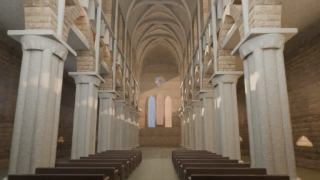
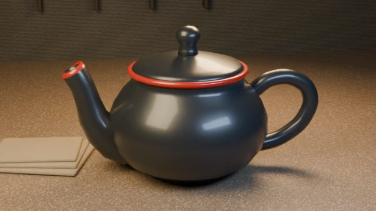
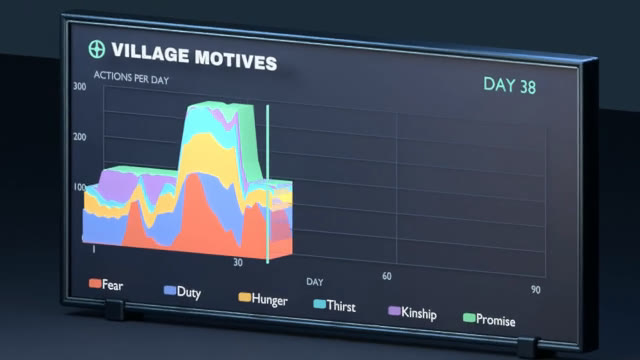
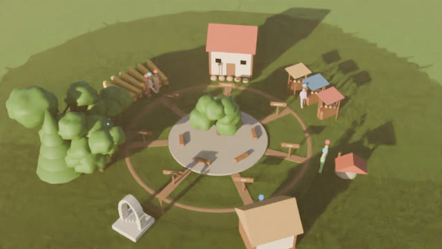
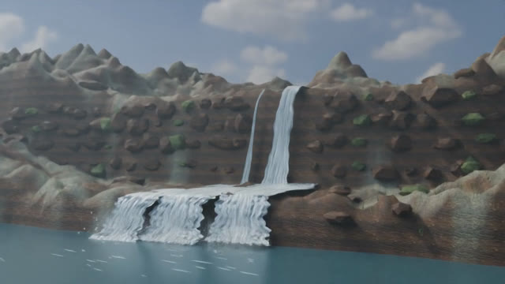

# Acceptance case studies

Explore all six end-to-end Studio runs. Each case includes a draft, a brief, a scene script, and review evidence.

[Browse the shipped example library](example-library.md) · [Reproduce an acceptance case](../acceptance/README.md#reproduce-a-scenario)

## [Gothic Nave](examples/gothic-nave.md)

Warm daylight travels across the stone aisle as the camera moves through pointed arches. The scene uses a prompt and open-licensed materials.

## [Fox Asleep](examples/fox-asleep.md)

A fox breathes while snow falls around it. The four-second loop was also rendered as a 1080p master and checked over two cycles.

## [Teapot from Photo](examples/teapot-from-photo.md)

One subject photo guides the charcoal glaze, red trim, and rounded silhouette. The reference board pairs the photo with the closest render frame.

## [Village Motives](examples/village-motives.md)

A physical chart builds from 90 days of simulation data. The scene also uses an SVG emblem, a font, and a shot list.

## [Society Village](examples/society-village.md)

An animated GIF sets the layout. Twelve figures reenact the simulation journal.

## [Iceland Falls](examples/iceland-falls.md)

Two photographs and a basalt model shape a stylized glacial waterfall.

## Browse all 36 scenes

The [example library](example-library.md) contains a playable draft, prompt, scene script, and review record for each shipped scene.
