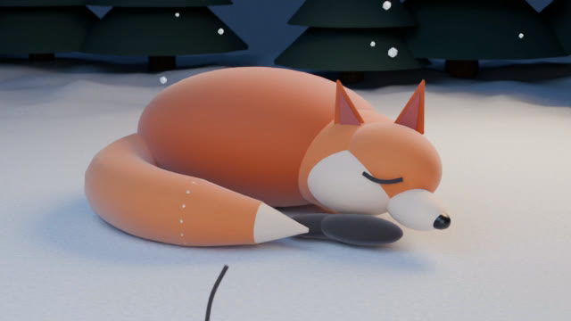

# Fox Asleep

A fox breathes while snow falls around it. The four-second loop was also rendered as a 1080p master and checked over two cycles.

## Brief excerpt

> The flank rises gently with each breath while snow falls in a seamless loop.

## Scene and review

[MP4 clip](../../acceptance/fox-asleep/result/clip.mp4) · [Scenario and brief](../../acceptance/fox-asleep/acceptance.json) · [Scene script](../../acceptance/fox-asleep/scene.py) · [Loop seam](../../acceptance/fox-asleep/result/seam.jpg) · [1080p master](../../acceptance/fox-asleep/result/master.mp4) · [Review record](../../acceptance/fox-asleep/result/review.json)

On GitHub, open the MP4 link and choose **View raw** or **Download raw file**.

[Back to all case studies](../examples.md)
