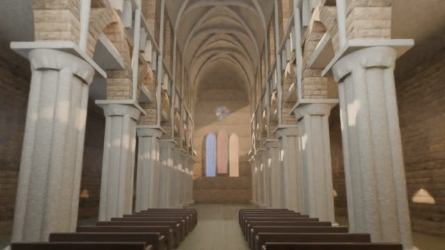

# Gothic Nave

Warm daylight travels across the stone aisle as the camera moves through pointed arches. The scene uses a prompt and open-licensed materials.

## Brief excerpt

> The camera dollies east past clustered limestone piers, pointed arcades, a recessed triforium and ribbed vaults.

## Scene and review

[MP4 clip](../../acceptance/gothic-nave/result/clip.mp4) · [Scenario and brief](../../acceptance/gothic-nave/acceptance.json) · [Scene script](../../acceptance/gothic-nave/scene.py) · [Timeline](../../acceptance/gothic-nave/result/timeline.jpg)

On GitHub, open the MP4 link and choose **View raw** or **Download raw file**.

[Back to all examples](../examples.md)
