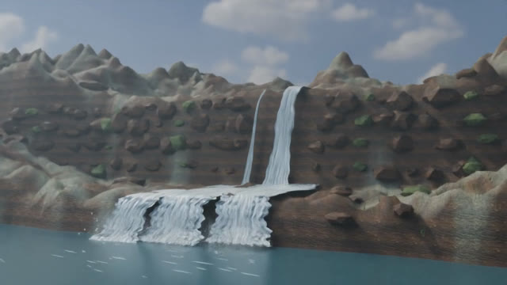

# Iceland Falls

Two reference photographs set the waterfall shape and palette. An original OBJ supplies a basalt block on the near bank as the camera glides toward the moving water.

## Brief excerpt

> A narrow upper ribbon falls down a mossy basalt cliff into a broad turquoise pool and rushes over a dark shelf as a wider, white curtain.

## Scene and review

[MP4 clip](../../acceptance/iceland-falls/result/clip.mp4) · [Scenario and brief](../../acceptance/iceland-falls/acceptance.json) · [Scene script](../../acceptance/iceland-falls/scene.py) · [Reference board](../../acceptance/iceland-falls/result/references.jpg) · [Review record](../../acceptance/iceland-falls/result/review.json)

The stylized draft passed its media checks. The review records the simpler vegetation, spray, and foreground detail alongside the photo and model input checks.

[Back to all case studies](../examples.md)
