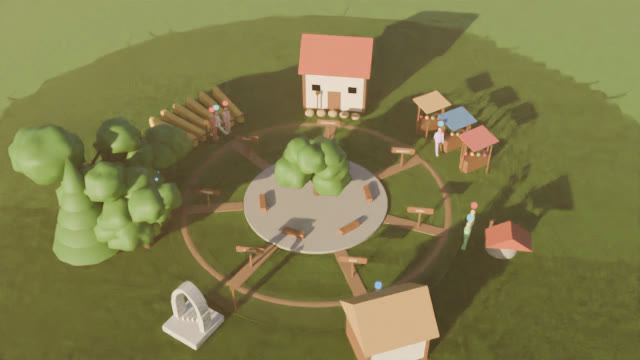

# Society Village

Twelve villagers reenact recorded simulation turns in a lantern-lit miniature. An animated GIF establishes the seven places around the commons, and a CSV drives the villagers' locations and motive colors.

## Brief excerpt

> Twelve villagers walk between the places following the moves recorded in the sim's journal, one recorded turn per second, each with a small gem over the head colored by the motive behind the action (fear, duty, hunger, thirst, kinship, promise).

## Scene and review

[MP4 clip](../../acceptance/society-village/result/clip.mp4) · [Scenario and brief](../../acceptance/society-village/acceptance.json) · [Scene script](../../acceptance/society-village/scene.py) · [Reference board](../../acceptance/society-village/result/references.jpg) · [Review record](../../acceptance/society-village/result/review.json)

The review checks the seven landmark positions against the diagram and all twelve villagers' settled locations and colors against the journal for turns 325–336.

[Back to all case studies](../examples.md)
