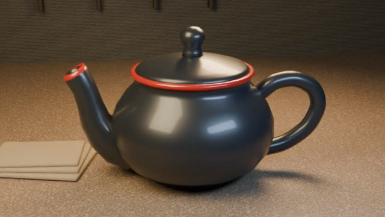

# Teapot from Photo

One subject photo guides the charcoal glaze, red trim, and rounded silhouette. The reference board pairs the photo with the closest render frame.

## Brief excerpt

> A slow rightward slide reveals the curve of the handle and keeps the entire silhouette in view.

## Scene and review

[MP4 clip](../../acceptance/teapot-from-photo/result/clip.mp4) · [Scenario and brief](../../acceptance/teapot-from-photo/acceptance.json) · [Scene script](../../acceptance/teapot-from-photo/scene.py) · [Reference board](../../acceptance/teapot-from-photo/result/references.jpg) · [Photo credit](../../acceptance/teapot-from-photo/inputs/CREDITS.txt) · [Review record](../../acceptance/teapot-from-photo/result/review.json)

On GitHub, open the MP4 link and choose **View raw** or **Download raw file**.

[Back to all case studies](../examples.md)
