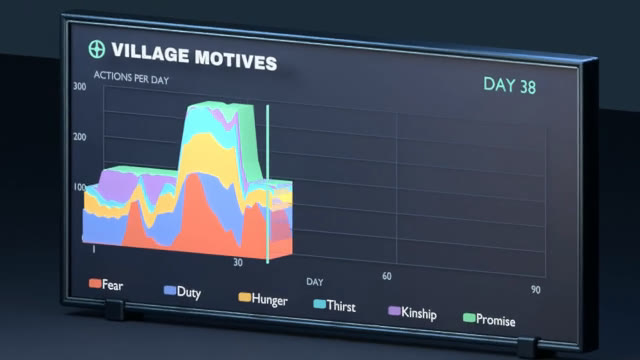

# Village Motives

A physical chart builds from 90 days of simulation data. The scene also uses an SVG emblem, a font, and a shot list.

## Brief excerpt

> Six colored bands follow the daily action counts in the CSV.

## Scene and review

[MP4 clip](../../acceptance/village-motives/result/clip.mp4) · [Scenario and brief](../../acceptance/village-motives/acceptance.json) · [Scene script](../../acceptance/village-motives/scene.py) · [Timeline](../../acceptance/village-motives/result/timeline.jpg) · [Review record](../../acceptance/village-motives/result/review.json)

On GitHub, open the MP4 link and choose **View raw** or **Download raw file**.

[Back to all case studies](../examples.md)
