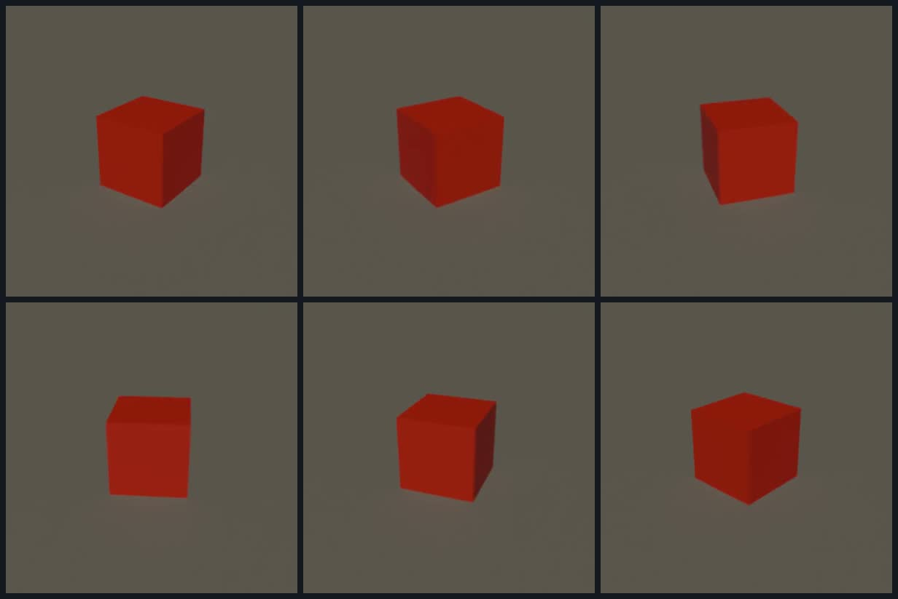

# First render

Render a red cube turning on a grey floor. You will write a short Blender scene, render a two-second draft, and inspect the resulting video and timeline.

## Check the renderer

Install Python 3.11+, [uv](https://docs.astral.sh/uv/), [Blender](https://www.blender.org/download/) 5.2+, and [FFmpeg](https://ffmpeg.org/download.html) with `libx264` and `ffprobe`. Run these commands in a POSIX shell on your render machine. If you already have a checkout, start at `uv sync` from its root.

```sh
git clone https://github.com/nicolas-found42/3d-agent-studio.git
cd 3d-agent-studio
uv sync --locked
uv run --locked 3d-agent-studio doctor
```

Check that Doctor reports Blender, FFmpeg, FFprobe, and `libx264: true`. If an executable is missing, set `STUDIO_BLENDER`, `STUDIO_FFMPEG`, or `STUDIO_FFPROBE` to its absolute path and rerun Doctor.

If you use pip, install `.` or `.[mcp]` in a virtual environment and run `3d-agent-studio` directly. The commands below use uv.

## Write and render the scene

The scene script defines `build(kit)`. Studio calls it inside Blender. The kit creates the ground, turns the cube, and adds the light and camera. This example uses a temporary directory for the script and render outputs.

```sh
studio_demo=$(mktemp -d "${TMPDIR:-/tmp}/studio-quickstart.XXXXXX")
cat > "$studio_demo/scene.py" <<'PY'
def build(kit):
    kit.ground()
    cube = kit.box("Cube", 1, (0, 0, .5), kit.material("Red", "#BD3026"))
    kit.spin(cube)
    kit.sun(azimuth=150)
    kit.camera(location=(2.8, -4, 2.8), target=(0, 0, .45), lens=50)
PY

uv run --locked 3d-agent-studio --output-root "$studio_demo/jobs" draft \
  '{"prompt":"A red cube turns on a grey floor","orientation":"square","seconds":2,"loop":true}' \
  "$studio_demo/scene.py" --wait
```

The draft runs a probe automatically before rendering the preview. The probe may take longer on the first Blender run as the GPU compiles its kernels.

## Inspect the result

The command prints a JSON job record. Check that `preview.state` is `ready`. Use the paths in `preview.artifacts` to play `reel.mp4` and open `timeline.jpg`. The timeline should show the red cube at six points in its turn. The job record also locates the editable `scene.blend`.



Use the same job root to look up the result later. Replace `JOB_ID` with the `job_id` from the draft output.

```sh
uv run --locked 3d-agent-studio --output-root "$studio_demo/jobs" status JOB_ID
```

If the render fails, read the stage's `error` and `run.log` in its job folder before retrying. For your own animation, follow the [render workflow](workflow.md), or [browse complete example scenes](examples.md) for a starting point.
