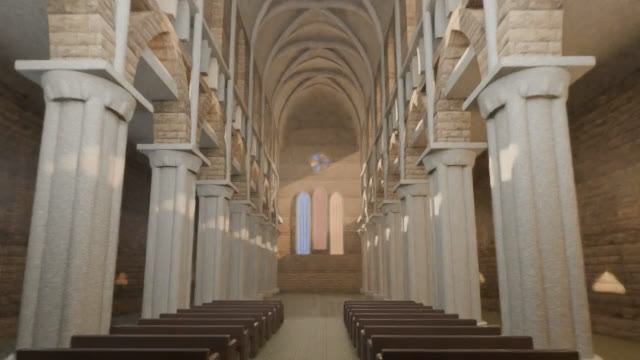
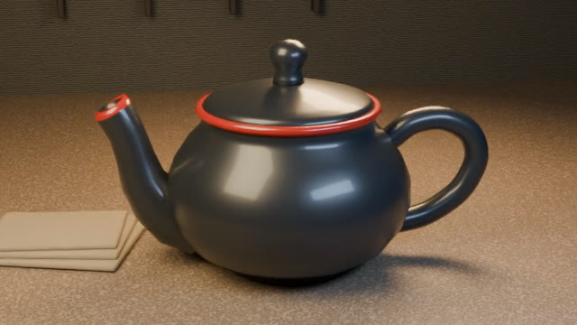
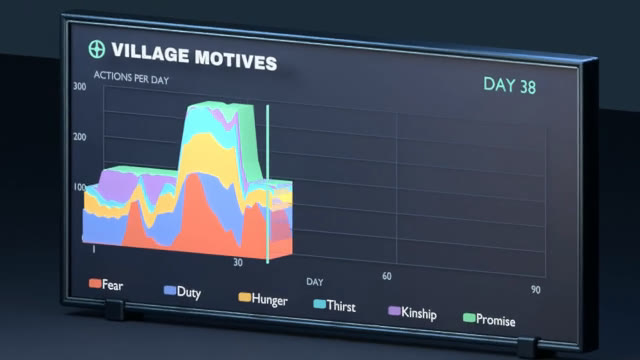

<section class="studio-hero" markdown="1">

# From prompt to Blender.

Write a Python scene or have your agent turn your prompt and references into one. Studio renders it locally for review and keeps the Blender project editable.

[Render a scene](docs/quickstart.md){ .studio-button .studio-button--primary }

[Connect an agent](docs/marketplace.md){ .studio-button .studio-button--quiet }

<figure class="studio-hero__art" markdown="1">

<figcaption markdown="1">

**Gothic Nave** [Watch the 5-second draft →](docs/examples.md#gothic-nave)

</figcaption>
</figure>

</section>

<section class="studio-section" markdown="1">

## What Studio renders

[All rendered examples →](docs/examples.md)

### [Fox Asleep](docs/examples.md#fox-asleep)

A procedural character with breathing and falling snow in a seamless loop.

### [Teapot from Photo](docs/examples.md#teapot-from-photo)

One reference photo guides a product shot with an editable model.

### [Village Motives](docs/examples.md#village-motives)

A CSV becomes a physical chart with a moving scan line.

</section>

<section class="studio-section studio-process" markdown="1">

## From draft to delivery

[Render workflow →](docs/workflow.md)

### Probe

Check framing and estimated render time from three stills.

### Draft

Watch the clip and inspect the timeline, angles, references, and loop seam when present.

### Master

Approve the draft evidence to render the full-resolution MP4 and keep the editable Blender project.

</section>

